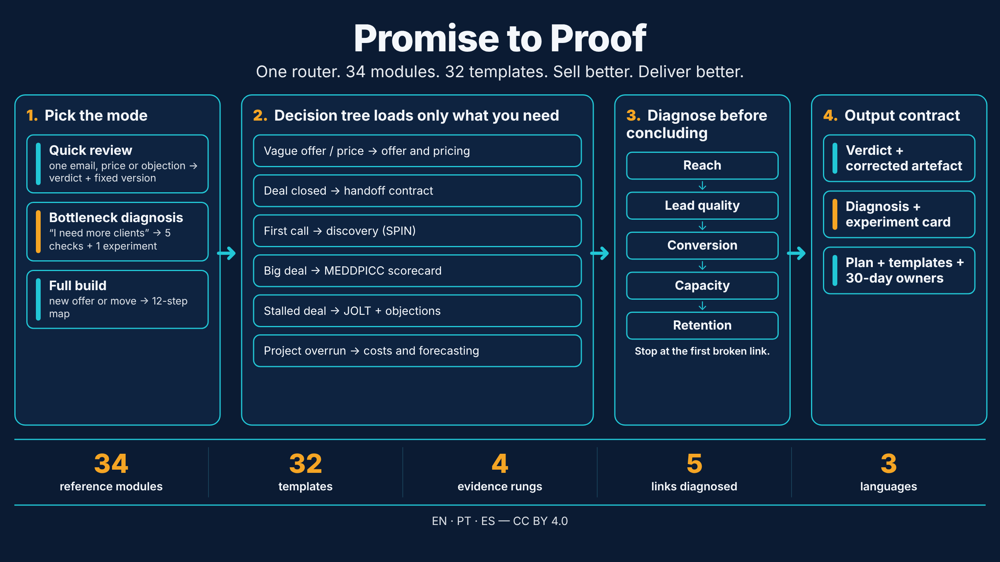
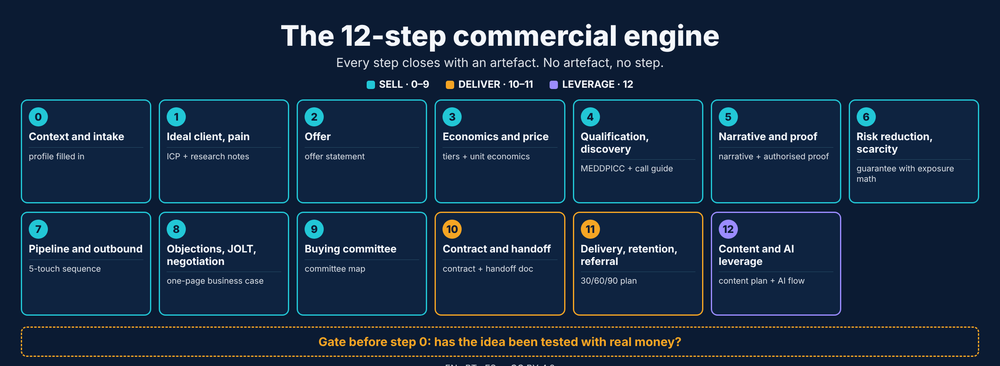
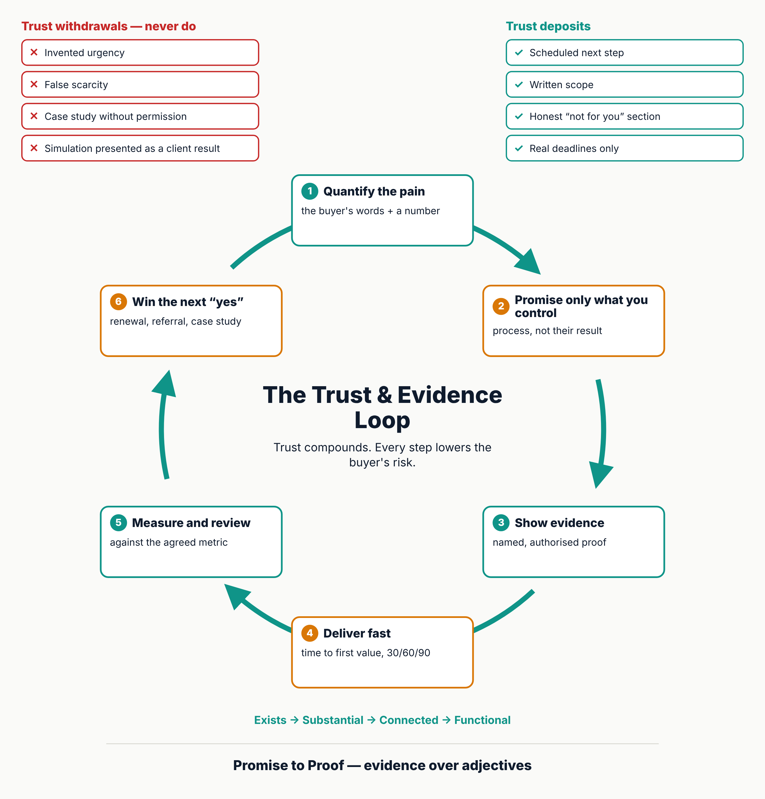

# Promise to Proof

[Português](README.md) · [English](README.en.md) · [Español](README.es.md)

> An agent skill to sell better and deliver better: from the first email to the measured result.

## What it is

Selling makes a promise; delivery keeps it. Most revenue is lost at the seam between them. **Promise to Proof** joins both in one skill: a router (`SKILL.md`) picks the smallest answer mode, loads only the needed module, and ends every recommendation in an artefact, a script or a number.

## Three modes

- **Quick review:** one email, price, proposal or status report. Output: one-line verdict and a corrected version.
- **Bottleneck diagnosis:** "I need more clients". Output: the 5 links (reach, lead quality, conversion, capacity, retention) and one experiment card.
- **Full build:** new offer, segment or project. Output: the sell map (12 steps) and the deliver map (6 steps).

## Contents

34 reference modules, 32 templates, 4 checklists, 7 examples, a library of 15 objections and a dependency-free validator (`scripts/validate_skill.mjs`). The bridge between selling and delivering is the **handoff contract** (`references/handoff-sell-to-deliver.md`), signed by both owners before kickoff.

## Languages

- [English](en/promise-to-proof/SKILL.md): `en/promise-to-proof/`
- [Português](pt/da-promessa-a-prova/SKILL.md): `pt/da-promessa-a-prova/`
- [Español](es/de-la-promesa-a-la-prueba/SKILL.md): `es/de-la-promesa-a-la-prueba/`

## Usage

Copy the folder of your language into your agent's skills directory. Validate with `node scripts/validate_skill.mjs <folder>`.

## License and sources

[CC BY 4.0](LICENSE) (Daniel de Souza Paixão, 2026). Attribution required. The skill synthesises third-party methods and standards; author figures are labelled "according to the author"; limits are in `references/sources.md`. Not legal, tax or accounting advice.

History: supersedes `business-sales-engine`, `commercial-engine-and-delivery`, `motor-comercial-e-gestao-pt` and `motor-comercial-y-gestion-es`. See the [CHANGELOG](CHANGELOG.md).
