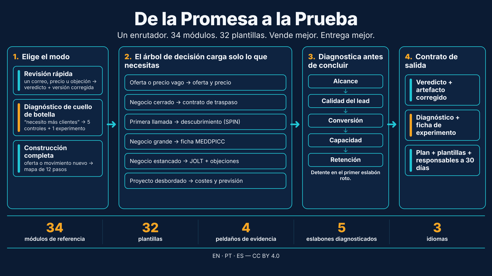
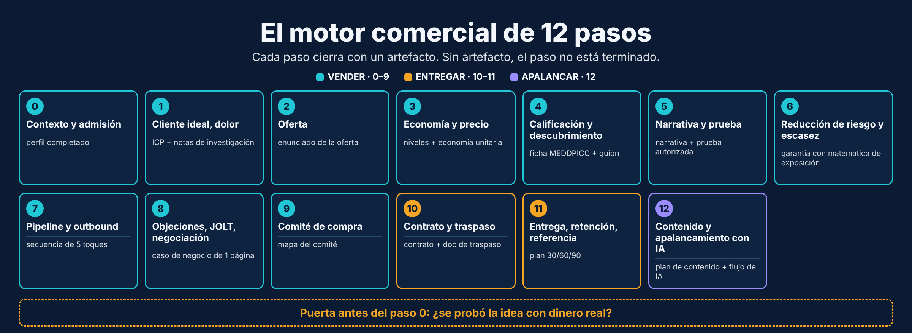
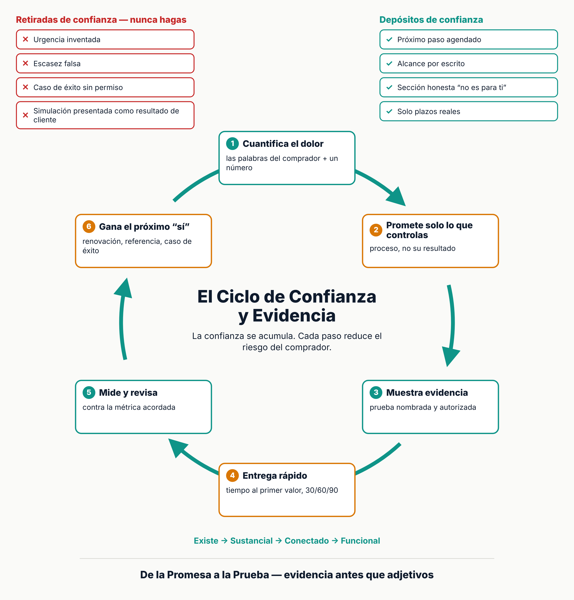

# De la Promesa a la Prueba

[Português](README.md) · [English](README.en.md) · [Español](README.es.md)

> Una skill de agente para vender mejor y entregar mejor: del primer correo al resultado medido.

## Qué es

Vender hace una promesa; entregar la cumple. La mayor falla suele estar en la frontera entre ambas. **De la Promesa a la Prueba** une las dos en una sola skill: un enrutador (`SKILL.md`) elige el modo de respuesta más pequeño, carga solo el módulo necesario y cierra cada recomendación con un artefacto, un guion o un número.

## Tres modos

- **Revisión rápida:** un correo, precio, propuesta o informe de estado. Salida: veredicto en una frase y versión corregida.
- **Diagnóstico de cuello de botella:** "necesito más clientes". Salida: los 5 eslabones (alcance, calidad del lead, conversión, capacidad, retención) y una ficha de experimento.
- **Construcción completa:** oferta, segmento o proyecto nuevo. Salida: mapa de vender (12 pasos) y entregar (6 pasos).

## Contenido

34 módulos de referencia, 32 plantillas, 4 checklists, 7 ejemplos, biblioteca de 15 objeciones y un validador sin dependencias (`scripts/validate_skill.mjs`). El puente entre vender y entregar es el **contrato de traspaso** (`references/handoff-sell-to-deliver.md`), firmado por ambos responsables antes del kickoff.

## Idiomas

- [English](en/promise-to-proof/SKILL.md): `en/promise-to-proof/`
- [Português](pt/da-promessa-a-prova/SKILL.md): `pt/da-promessa-a-prova/`
- [Español](es/de-la-promesa-a-la-prueba/SKILL.md): `es/de-la-promesa-a-la-prueba/`

## Uso

Copia la carpeta de tu idioma al directorio de skills de tu agente. Valida con `node scripts/validate_skill.mjs <carpeta>`.

## Licencia y fuentes

[CC BY 4.0](LICENSE) (Daniel de Souza Paixão, 2026). Atribución obligatoria. La skill sintetiza métodos y normas de terceros; las cifras de autores se marcan "según el autor"; los límites están en `references/sources.md`. No es asesoría legal, tributaria ni contable.

Historial: reemplaza `business-sales-engine`, `commercial-engine-and-delivery`, `motor-comercial-e-gestao-pt` y `motor-comercial-y-gestion-es`. Ver el [CHANGELOG](CHANGELOG.md).
