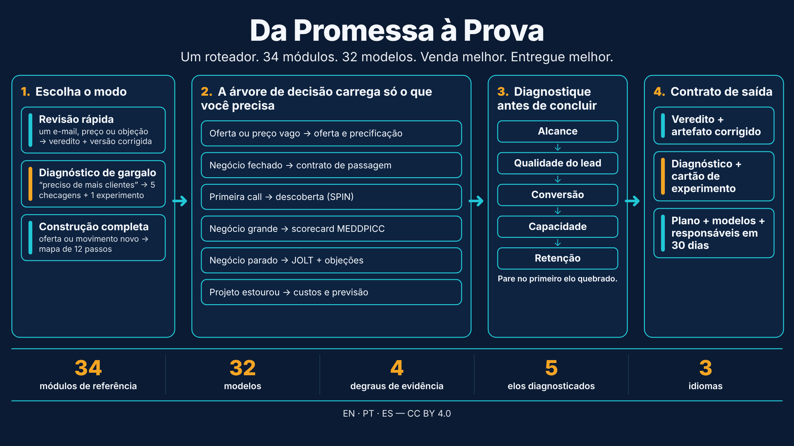
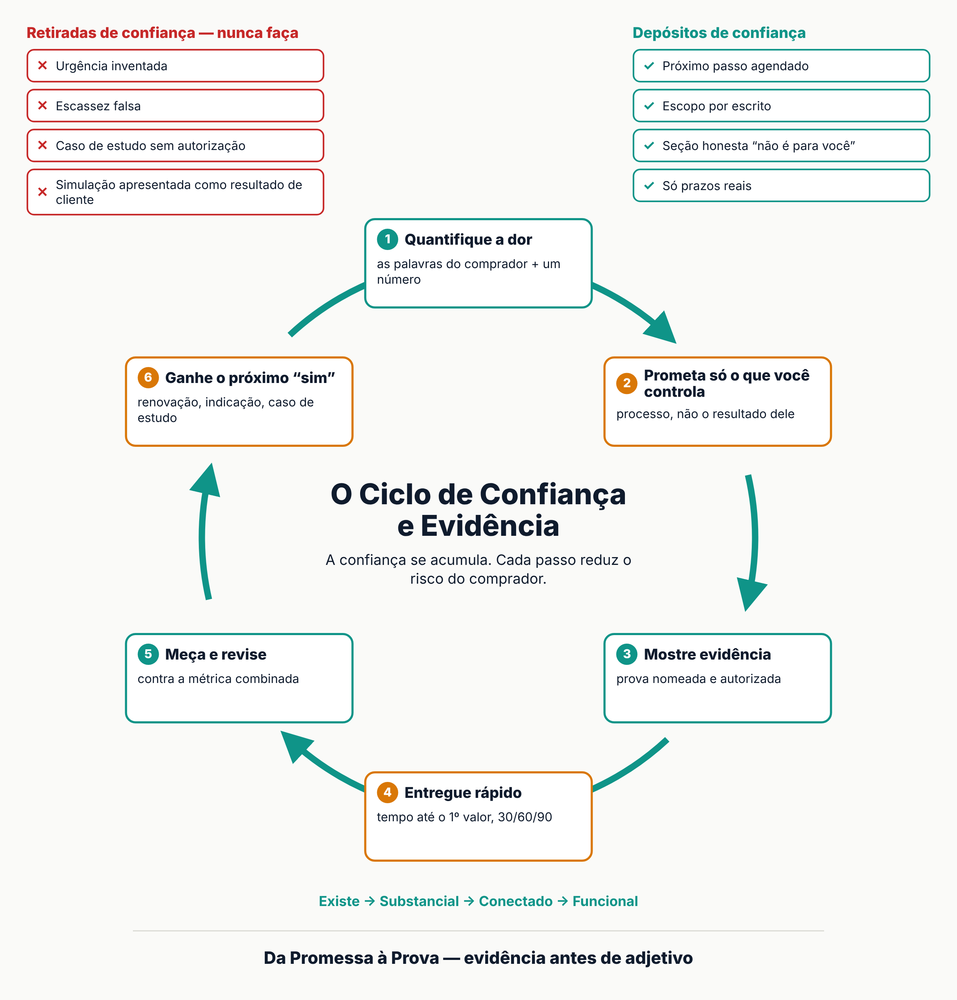

# Da Promessa à Prova

[Português](README.md) · [English](README.en.md) · [Español](README.es.md)

> Uma skill de agente para vender melhor e entregar melhor: do primeiro e-mail ao resultado medido.

## O que é

A frente comercial promete; a frente de entrega cumpre. A maior falha costuma estar na fronteira entre as duas. **Da Promessa à Prova** junta as duas em uma única skill, com um roteador (`SKILL.md`) que escolhe o menor modo de resposta, carrega só o módulo necessário e fecha cada recomendação com um artefato, um roteiro ou um número.

## Três modos

- **Revisão rápida:** um e-mail, preço, proposta ou relatório. Saída: veredito em uma frase e versão corrigida.
- **Diagnóstico de gargalo:** "preciso de mais clientes". Saída: os 5 elos (alcance, qualidade do lead, conversão, capacidade, retenção) e um cartão de experimento.
- **Construção completa:** oferta, segmento ou projeto novo. Saída: mapa de vender (12 passos) e entregar (6 passos).

## Conteúdo

34 módulos de referência, 32 modelos, 4 checklists, 7 exemplos, biblioteca de 15 objeções e um validador sem dependências (`scripts/validate_skill.mjs`). O elo entre vender e entregar é o **contrato de passagem** (`references/handoff-sell-to-deliver.md`), assinado pelos dois responsáveis antes do kickoff.

## Idiomas

- [English](en/promise-to-proof/SKILL.md): `en/promise-to-proof/`
- [Português](pt/da-promessa-a-prova/SKILL.md): `pt/da-promessa-a-prova/`
- [Español](es/de-la-promesa-a-la-prueba/SKILL.md): `es/de-la-promesa-a-la-prueba/`

## Como usar

Copie a pasta do seu idioma para o diretório de skills do seu agente. Valide com `node scripts/validate_skill.mjs <pasta>`.

## Licença e fontes

[CC BY 4.0](LICENSE) (Daniel de Souza Paixão, 2026). Atribuição obrigatória. A skill sintetiza metodologias e normas de terceiros; números de autores entram como "segundo o autor", e as limitações estão em `references/sources.md`. Não é aconselhamento jurídico, tributário ou contábil.

Histórico: substitui `business-sales-engine`, `commercial-engine-and-delivery`, `motor-comercial-e-gestao-pt` e `motor-comercial-y-gestion-es`. Veja o [CHANGELOG](CHANGELOG.md).
